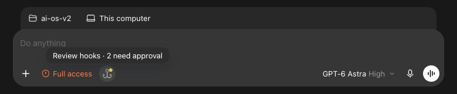
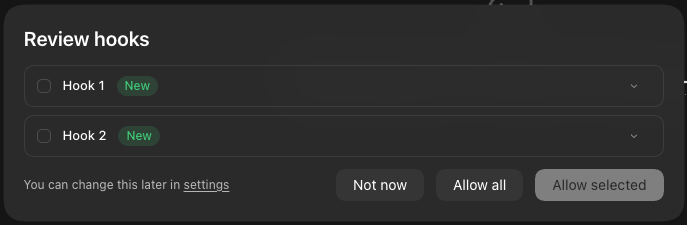
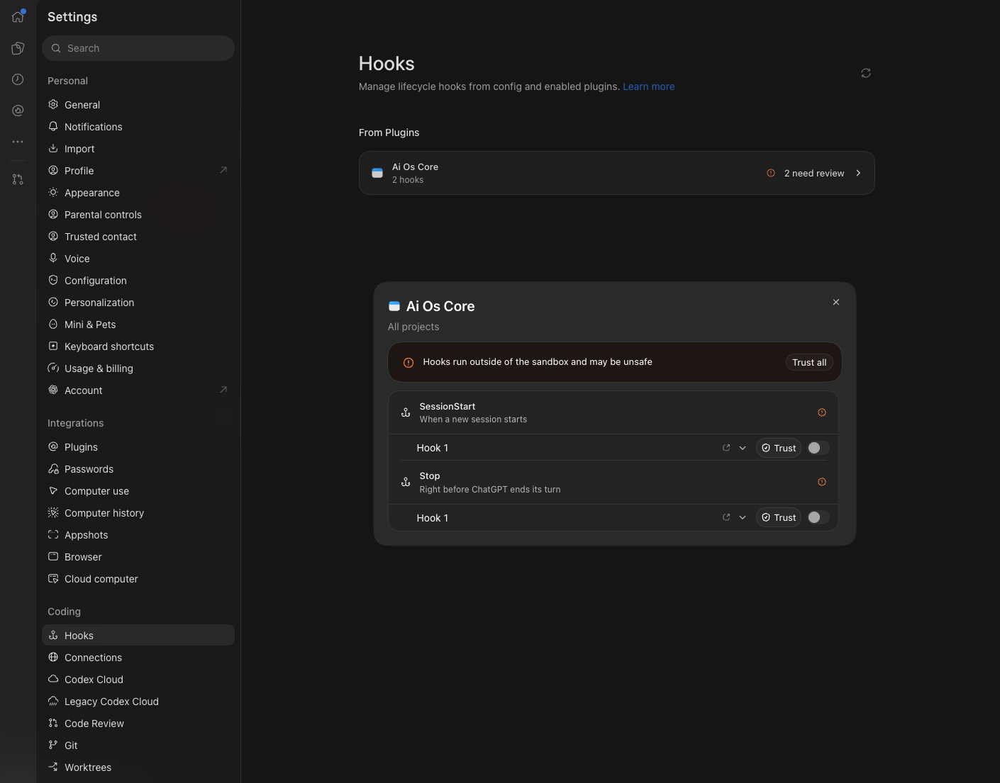
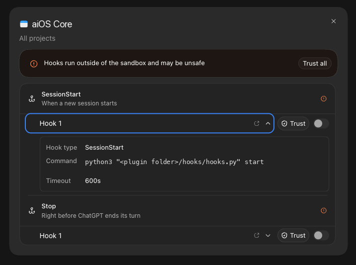
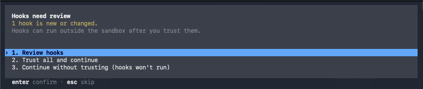
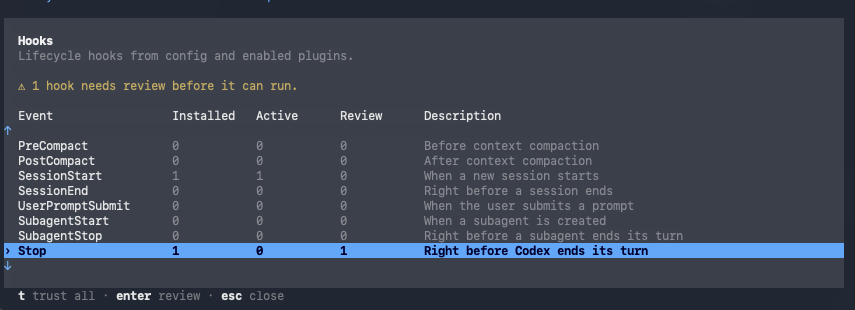
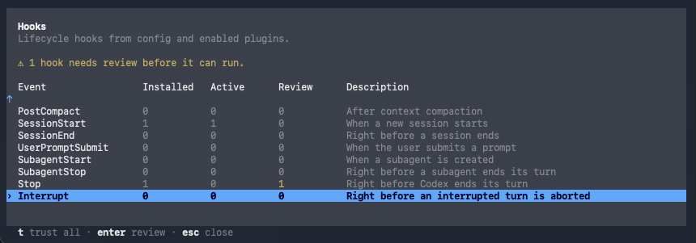

# Install and enable aiOS checks

Install aios-core, enable checks for a folder, and verify that hooks run.

Before you start, you need Claude Code or Codex installed, and Python 3.9 or later. Run `python3 --version` to check Python.

For local development, use the product repo's absolute path as the marketplace source.

## 1. Install the plugin

Claude Code:

```bash
claude plugin marketplace add MYRS-ai/aiOS
claude plugin install aios-core@aios --scope user
```

Codex:

```bash
codex plugin marketplace add MYRS-ai/aiOS
codex plugin add aios-core@aios
```

## 2. Set up a folder

1. Start an agent session in the folder where you want to set up aiOS.
2. Ask the agent in plain words, for example "Set up aiOS in this folder."
3. Confirm workspace names after the agent interviews you about your domains, files, and preferences.

The agent harness picks the matching skill. In Claude Code you can also type `/aios-core:setup-aios`.

The skill includes a complete fictional example and adaptation guidance. The agent uses relevant files to structure your confirmed context and work.

Setup creates settings, a docs copy, top-level and workspace contracts, workspace glossaries, and `shared/`. It adds `.aiOS/logs/` to `.gitignore`. Existing files are skipped and reported. Re-running setup adds missing pieces.

Settings apply to the folder containing `.aiOS/config.yaml` and its contents. Checks skip subfolders with their own `.aiOS/config.yaml`.

The skill runs this script after confirming workspaces:

```bash
python3 "<core plugin>/skills/setup-aios/scripts/setup.py" [folder] --workspace NAME="PURPOSE"
```

Repeat `--workspace` for each workspace. The folder defaults to the current folder.

`<core plugin>` means the `aios-core` folder:

| Environment | Plugin folder |
|---|---|
| Claude Code | `~/.claude/plugins/cache/aios/aios-core/<version>/` |
| Codex | `~/.codex/plugins/cache/aios/aios-core/<version>/` |
| Source checkout | `<product repo>/plugins/aios-core` |

After setup:

- Run `aios-core:verify-aios` from the folder you set up to verify the result.
- Review skipped contracts' Contents sections for any new workspace links.

## 3. Approve the hooks (Codex only)

Codex skips plugin hooks until you approve them. Claude Code requires no hook approval.

### Codex app

A hooks badge appears next to the prompt box:



Click it, then choose **Allow all**:



Hooks are also under **Settings > Hooks**. Each hook shows the command it runs:





### Codex CLI

At startup, Codex asks you to review new hooks. Choose **Trust all and continue**:



`/hooks` shows each event. The **Review** column counts hooks still waiting. Press `t` to trust all:



Scroll down in the table to see every event:



### When approval expires

Codex asks again when a definition in `hooks/hooks.json` changes. Plugin version updates and script changes keep the approval, as tested from 0.2.0 to 0.2.1.

## 4. Verify the hooks

1. Start a new session in the folder.
2. Send a message and let the turn finish.
3. Invoke the `aios-core:verify-aios` skill from the same folder, or run:

   ```bash
   python3 "<core plugin>/skills/verify-aios/scripts/status.py"
   ```

The status report shows settings, versions, hook runs, and results from enabled checks on files within their configured scope. Each agent harness you have used should show its last hook run:

```text
Hooks
  claude-code: last ran 2026-10-03T16:33:50-07:00
  codex: last ran 2026-10-03T16:50:12-07:00
```

"never ran here" means the log has no hook run for that agent harness. If you already used that agent harness here, check installation and hook approval.

The Files section should end with `Problems: 0`. Hooks fill in timestamps when a turn ends, so the report doesn't count missing timestamps.

## 5. Update the plugin

Plugin updates are off by default for this marketplace. Update each agent harness that you use.

Claude Code:

```bash
claude plugin marketplace update aios
claude plugin update aios-core@aios
```

Codex:

```bash
codex plugin marketplace upgrade aios
codex plugin add aios-core@aios
```

The Codex marketplace command refreshes the catalog; the add command installs the plugin from that catalog.

After updating:

1. Start a new session.
2. Approve changed hook definitions in Codex.
3. Run `aios-core:verify-aios` again.

The setup and diagnostic skills are now named `aios-core:setup-aios` and `aios-core:verify-aios`.
Update existing references from `aios-core:setup` to `aios-core:setup-aios`, and from `aios-core:status` to `aios-core:verify-aios`.
`aios-core:check-aios`, used during source review, also becomes `aios-core:verify-aios`.
The docs copy refreshes automatically; operator contracts remain operator-maintained files.
